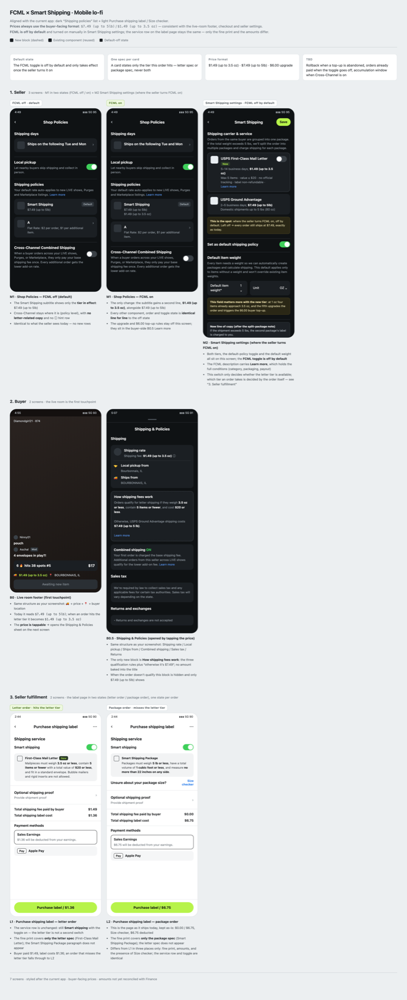

# FCML × Smart Shipping — Mobile lo-fi

Low-fidelity mobile prototype for adding a **First-Class Mail Letter (FCML)** tier to Smart Shipping.

**Live:** https://julialipalmstreet.github.io/fcml-smart-shipping-lofi/

## Screens (7)

| # | Screen | What it shows |
|---|---|---|
| M1 | Shop Policies — FCML **off** | What the seller sees today: subtitle shows only `$7.49 (up to 5lb)` |
| M1 | Shop Policies — FCML **on** | The only change: a second price line, `$1.49 (up to 3.5 oz)` |
| M2 | Smart Shipping settings | Where the seller turns FCML on — off by default |
| B0 | Live room footer | Buyer-facing price in the live room, tappable |
| B0.5 | Shipping & Policies sheet | New **How shipping fees work** block |
| L1 | Purchase shipping label — letter order | Fine print covers only the letter spec |
| L2 | Purchase shipping label — package order | Page as it ships today; fine print covers only the package spec |

## Conventions

- Prices always use the buyer-facing format: `$7.49 (up to 5lb)` / `$1.49 (up to 3.5 oz)`
- Dashed border = new block, solid = existing component
- The two label-page states are mutually exclusive — one state per order
- Amounts are illustrative and not yet reconciled with Finance

## Run

Single self-contained HTML file — open `index.html` directly. No build step, no dependencies.

> Mock data (seller handle, buyer names, city) is fictional.
